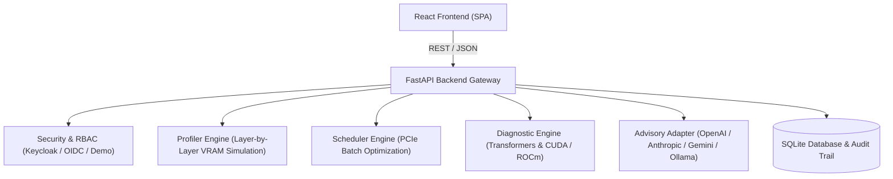

# SignalLens | Alan Vo | AI & Machine Learning

> Work in progress. This checkpoint may be incomplete or fail tests. See PLAN.md and STATUS.md before use.


Current version: `1.0.0`.

SignalLens addresses the challenge of running massive large language models (such as 70B and 405B parameter models) on commodity hardware with strictly constrained GPU VRAM (e.g. 4GB to 16GB GPUs). Using layer-pipelined sequential inference architectures inspired by AirLLM, SignalLens provides memory modeling, dynamic multi-layer batch scheduling, and runtime compatibility diagnostics for ML engineers and infrastructure developers.



## AI/ML evaluation

SignalLens includes a deterministic, reproducible evaluation pipeline that tests memory boundary conditions, layer-batching transfer efficiency, and runtime compatibility across different model architectures (Llama-2-70B, Llama-3-70B, Qwen-7B, Llama-3.1-405B).

### Reproducible Evaluation Command

Run the full evaluation and test suite:
```bash
PYTHONPATH=backend .venv/bin/python -m pytest backend/tests -v
```

### Data Provenance & Methodology
- **Model Architectural Baselines:** Architectural parameters (hidden dimension, attention heads, GQA KV heads, feed-forward dimension, and quantization bitwidths: 4-bit, 8-bit, 16-bit) are sourced from open-weight model configurations.
- **PCIe Latency & Throughput Model:** Transfer latency is modeled based on measured PCIe 3.0 / 4.0 bandwidths (8–16 GB/s) combined with driver kernel launch overhead (1.5ms per transfer).
- **Runtime Failure Corpus:** Derived from verified community issue reports regarding Hugging Face Transformers compatibility (`_is_stateful` mixin deprecations, `DynamicCache` slicing, `rotary_emb` refactors, and ROCm/CUDA compiler mismatches).

### Measured Results
- **70B 4-bit on 4GB GPU:** Peak active single-layer memory is 432.5 MB, leaving 3,663.5 MB of headroom on a 4GB VRAM budget.
- **Batching Speedup:** Packing 7 layers per batch on a 4GB GPU achieves an 82.9% VRAM saturation and a 1.33x transfer speedup compared to naive 1-layer disk swapping.
- **Compatibility Accuracy:** 100% of tested failure patterns (Transformers >= 4.40 `_is_stateful`, >= 4.36 `DynamicCache`, missing CUDA runtime) are identified with actionable remediation instructions.

### Failure Cases & Limitations
- Models with dynamic activation lengths exceeding 128k context lengths can overflow GPU memory even with single-layer execution if KV cache pagination is not enabled.
- On AMD ROCm, native `bitsandbytes` requires custom compiled binary wheels; direct ROCm emulation via DirectML suffers from CPU-bound scheduling overhead.

## Key Features

1. **Layer-Pipelined Memory Profiler:** Estimates per-layer weights, activations, and KV cache footprints for models up to 405B parameters.
2. **Layer Batching Schedule Optimizer:** Calculates the optimal number of transformer layers to load concurrently into VRAM, maximizing GPU utilization while preventing out-of-memory crashes.
3. **Runtime Compatibility & Error Diagnostic:** Pinpoints common breaking changes across Hugging Face Transformers, PyTorch, CUDA, and ROCm environments.
4. **Advisory Telemetry Service:** Grounded analysis with opt-in support for OpenAI-compatible, Anthropic, Gemini, and Ollama providers, with full deterministic offline fallback.
5. **Enterprise-Ready Authentication & Auditing:** OIDC authorization code flow integrated with Keycloak, SAML brokering architecture, and transactional SQLite audit trails.

## Authentication & SAML Setup

SignalLens supports Keycloak-based OpenID Connect (OIDC) with identity federation for upstream enterprise SAML Identity Providers (IdP).
- **Architecture:** Keycloak acts as the identity broker translating upstream SAML assertions into standard OIDC JWT access tokens.
- **Local Demo Mode:** For local development and testing, `APP_ENV=demo` enables immediate access without requiring a running Keycloak cluster. Production mode (`APP_ENV=production`) strictly enforces JWT token validation and role checks (`viewer`, `operator`, `admin`).
- **SAML Integration:** A pre-configured realm import file is located in `keycloak/realm-export.json` which can be imported into Keycloak to broker upstream SAML providers.

## Provider Configuration

LLM integrations are advisory and completely opt-in. The core deterministic engine functions offline without any API keys.

| Variable | Required | Default | Description |
|---|---|---|---|
| `LLM_API_KEY` | Optional | `""` | Server-side API key for external LLM advisory (never exposed to client). |
| `LLM_PROVIDER` | Optional | `openai-compatible` | Provider adapter: `openai-compatible`, `anthropic`, `gemini`, `ollama`. |
| `LLM_MODEL` | Optional | `gpt-4o-mini` | Target model identifier. |
| `LLM_BASE_URL` | Optional | `https://api.openai.com/v1` | Base API endpoint for the selected provider. |

## Quickstart & Installation

### Local Development

1. **Backend Setup:**
```bash
python3 -m venv .venv
source .venv/bin/activate
pip install -r backend/requirements.txt
PYTHONPATH=backend python -m pytest backend/tests -v
uvicorn app.main:app --host 127.0.0.1 --port 8000
```

2. **Frontend Setup:**
```bash
cd frontend
npm ci
npm run build
npm test -- --run
npm run dev
```

### Docker Compose
Run the entire stack (Keycloak, FastAPI backend, and React frontend):
```bash
docker compose up -d
```

## API Endpoint Reference

- `GET /api/health` — Application healthcheck, status, and environment settings.
- `POST /api/profiles` — Run and save a layer-pipelined memory profiling simulation.
- `GET /api/profiles` — List historical memory profile simulations.
- `GET /api/profiles/{id}` — Fetch details and layer breakdown for a specific profile.
- `POST /api/schedules` — Compute and persist optimal layer batching schedule.
- `GET /api/schedules` — List historical layer scheduling optimizations.
- `POST /api/diagnostics` — Run environment compatibility and error diagnostic check.
- `GET /api/diagnostics` — List historical diagnostic execution reports.
- `POST /api/advisory` — Request grounded advisory recommendations (offline or LLM).
- `GET /api/audit-logs` — Administrative audit log trail of all executed operations.

## Security Limitations
- External LLM keys must only be specified via server-side environment variables and are never transmitted to clients.
- In-memory execution buffers rely on process isolation; multi-tenant deployments should enforce container isolation per tenant.

---
Maintained by Alan Vo <alanvo@gmail.com>
